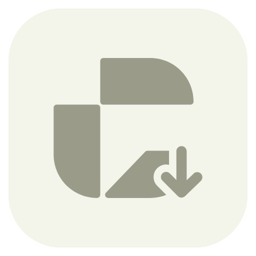
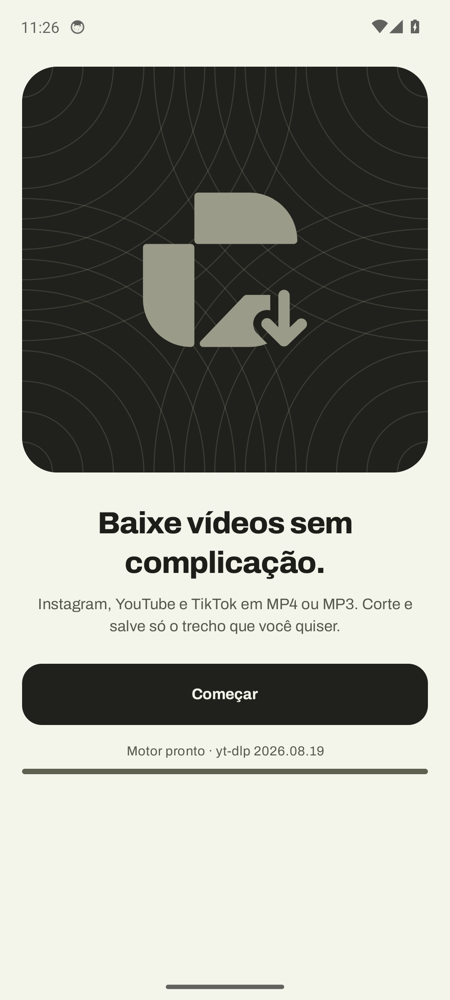
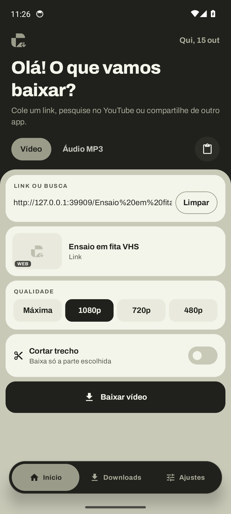
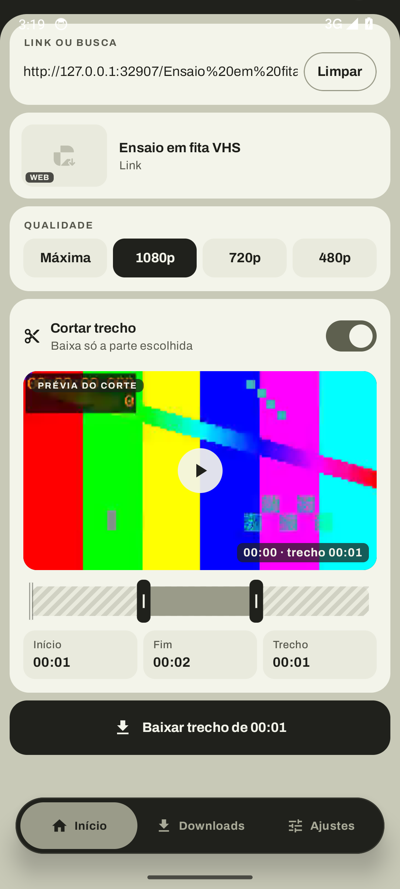
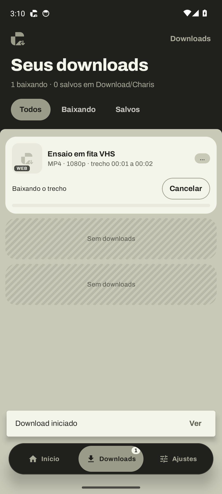
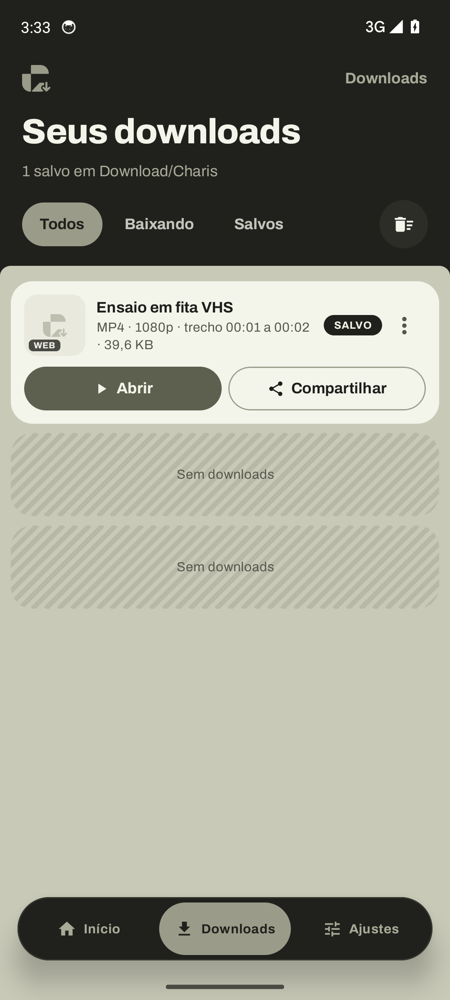
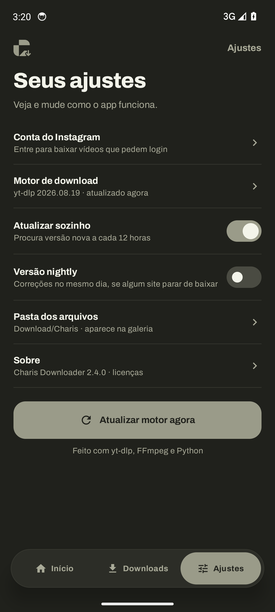
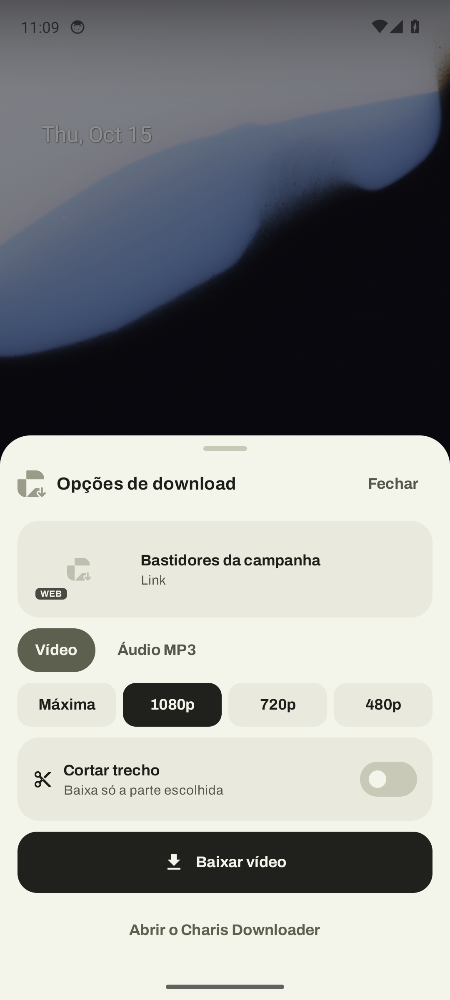
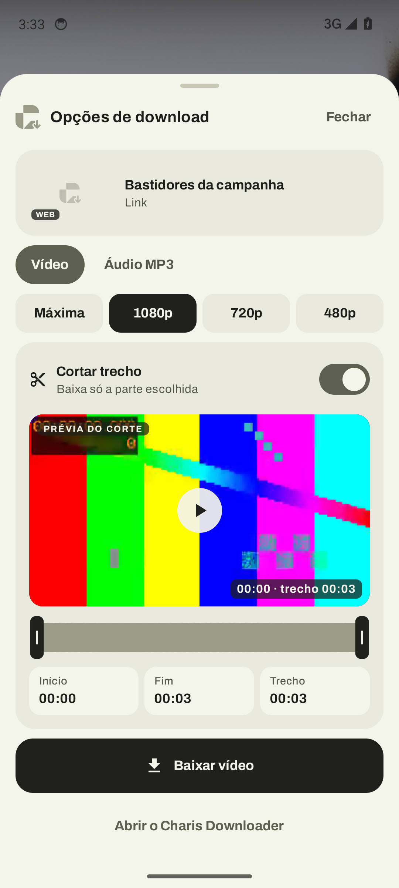
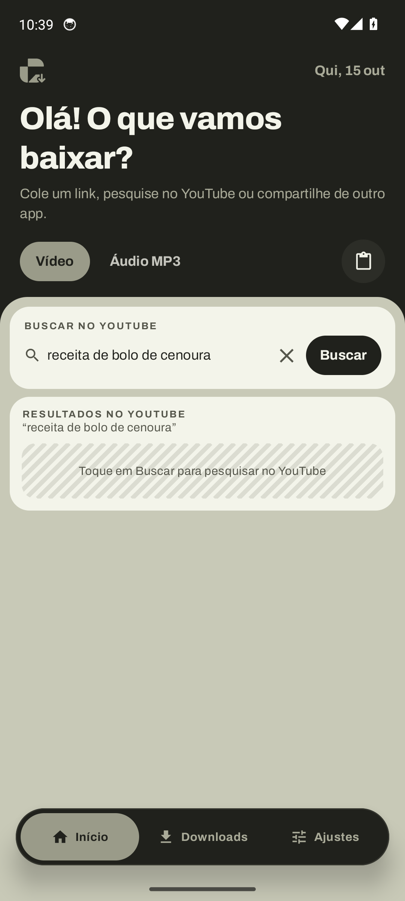

# Charis Downloader



App Android para baixar vídeos e áudios do Instagram, YouTube e TikTok (e de centenas de outros sites
suportados pelo yt-dlp), inteiros ou só um trecho, com as cores do logo Charis.

## Instalar

1. Pegue o APK na pasta `apk/` desta pasta (ou em Releases / Actions do GitHub):
   - `CharisDownloader-arm64-v8a.apk`: serve em quase todos os celulares.
   - `CharisDownloader-armeabi-v7a.apk`: só se o primeiro não instalar (celulares antigos ou Android Go).
2. Abra o arquivo no celular e permita "instalar apps desconhecidos" quando o Android pedir.
   Quem já tem o Baixa Vídeos instalado recebe o Charis Downloader como atualização, sem perder nada.
3. Na primeira abertura o app prepara o motor (alguns segundos) e atualiza o yt-dlp sozinho.

Requer Android 7.0 ou mais novo. A página `index.html` desta pasta é a prévia interativa do app.

| Boas-vindas | Início | Corte com prévia | Baixando | Concluído |
| --- | --- | --- | --- | --- |
|  |  |  |  |  |

| Ajustes | Compartilhar | Compartilhar com corte | Busca |
| --- | --- | --- | --- |
|  |  |  |  |

## Usar

- Cole o link no **Início**: o app mostra título, miniatura e duração do vídeo.
- **Pesquisar no YouTube:** no mesmo campo, digite o que procura e toque em **Buscar**. Escolha um
  resultado e ele vira o link do download (com prévia, qualidade e corte).
- Escolha **Vídeo** (Máxima, 1080p, 720p ou 480p) ou **Áudio MP3** e toque em **Baixar**.
- **Cortar trecho:** ligue o corte, arraste as duas alças (ou toque em Início e Fim para digitar o
  tempo exato) e toque no play da prévia para assistir só a parte que vai ser baixada. O app baixa
  só o trecho e acerta o corte no próprio celular, com barra de progresso.
- No Instagram, YouTube ou TikTok, toque em **Compartilhar** e escolha **Charis**: abre uma janela por
  cima do app com as mesmas opções (formato, qualidade e corte). Nada começa sem você escolher.
- Os arquivos ficam em `Download/Charis` e aparecem na galeria e no app de música.
- O Instagram pediu login? **Ajustes → Conta do Instagram** (login no site oficial, salvo só no aparelho).
- Algum site parou de baixar? **Ajustes → Atualizar motor agora**, ou ligue a versão nightly.
- Os downloads continuam com o app em segundo plano (com notificação de progresso).

## Como funciona

- O motor é o [yt-dlp](https://github.com/yt-dlp/yt-dlp) rodando no próprio celular, com Python,
  FFmpeg e QuickJS empacotados pela biblioteca
  [youtubedl-android](https://github.com/yausername/youtubedl-android).
- O app atualiza o yt-dlp direto das releases do GitHub (a cada 12 h, ou pelo botão em Ajustes).
  Isso é o que mantém YouTube, Instagram e TikTok funcionando quando os sites mudam.
- A prévia do link pede ao yt-dlp só os dados do vídeo (`--skip-download`), incluindo um endereço em
  resolução baixa que o player da prévia (AndroidX Media3) toca direto do site. Quando o site recusa
  (o TikTok responde 403 fora do app dele), o app baixa uma cópia leve (até 480p) de vídeos de até
  10 minutos e toca a cópia.
- O corte baixa só o trecho com `--download-sections`, copiando os dados sem recodificar (rápido).
  O arquivo copiado começa no quadro-chave anterior ao início; o FFmpeg do aparelho então recodifica
  o trecho com o codificador de hardware do celular (`h264_mediacodec`, bem mais rápido que o
  processador) e o resultado começa e termina no segundo escolhido. Se o aparelho recusar o
  codificador de hardware, o app usa o x264 em modo rápido. Se baixar só o trecho falhar ou ficar
  60 segundos sem resposta, o app baixa o vídeo inteiro e corta no aparelho.
- A busca usa `ytsearch` do yt-dlp com `--flat-playlist`, que traz só a lista de resultados.
- Cada download roda numa pasta privada do app e o resultado é copiado para `Download/Charis`.
- O progresso vem de linhas próprias pedidas ao yt-dlp (`--print` e `--progress-template` em JSON),
  então o app não depende do texto de log do yt-dlp.

Código principal em `app/src/main/java/com/joohn/baixavideos`:

| Pasta | O que tem |
| --- | --- |
| `engine/` | motor, fila de downloads, leitura de dados do link, saída do yt-dlp, atualizador, Instagram, salvamento |
| `service/` | serviço em primeiro plano e notificações |
| `ui/` | telas em Jetpack Compose (boas-vindas, início, downloads, ajustes, janela de compartilhar) |
| `ui/trim/` | cartão de corte: player da prévia, linha do tempo e tempos exatos |
| `data/` | preferências e histórico |

## Compilar

```bash
./gradlew assembleRelease        # JDK 17 e Android SDK 37
```

Gera um APK por arquitetura em `app/build/outputs/apk/release/`. Um APK universal passaria de
200 MB, porque Python e FFmpeg são binários nativos de cada arquitetura.

O workflow `.github/workflows/baixa-videos.yml`:

- compila os APKs e anexa como artefatos a cada push;
- roda os testes instrumentados num emulador Android 14 (motor, download e MP3 de um vídeo local,
  corte de vídeo e de áudio pelos dois caminhos com conferência da duração, prévia do link e do
  player, e tentativas com links reais de download, corte e busca), percorre as telas e guarda log
  e capturas;
- se os testes passarem e o workflow for rodado com a opção "salvar" marcada (ou o commit tiver
  `[salvar-apk]` na mensagem), grava os APKs em `apk/` e as capturas de tela em `docs/screenshots/`;
- em `main`, publica os APKs numa Release.

**Assinatura:** a chave em `app/keystore/` é do projeto e fica no repositório de propósito, para toda
build ter a mesma assinatura e o app atualizar sem desinstalar. Para usar uma chave privada, defina
`BV_KEYSTORE_FILE`, `BV_KEYSTORE_PASSWORD`, `BV_KEY_ALIAS` e `BV_KEY_PASSWORD` no ambiente de build
(a troca de chave exige desinstalar a versão antiga uma vez).

## Licença

GPL-3.0 (veja `LICENSE`), porque o app usa a biblioteca youtubedl-android, que é GPL-3.0.
A fonte Archivo é da SIL Open Font License 1.1 (texto em `app/src/main/assets/licenses/`).

Use com responsabilidade: baixe só o que você tem direito de usar e respeite quem criou o conteúdo.
